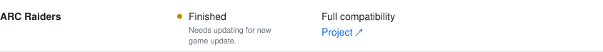

# Mac Gaming Compatibility

Updated 29 October 2026

   
   
  

Not every game listed is guaranteed to reach full compatibility. Maintaining compatibility with new CrossOver versions, macOS versions, or game updates depends on the time I have available.

## Community

[Suggestions, feedback & general chat ↗](https://github.com/zzoko/mac-gaming-compatibility/discussions/2)

## Support

Optional contributions help support the compatibility work.

  &nbsp;
  

